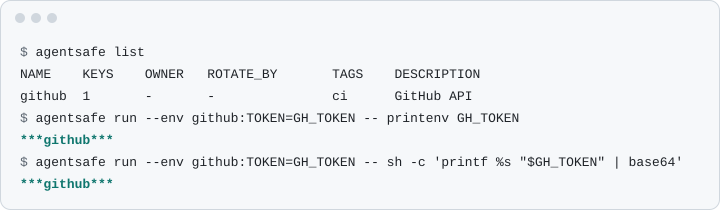

<p align="center"></p>

<h1 align="center">agentsafe</h1>

<p align="center">A secrets manager for AI agents: names for the agent, values for the commands it runs.</p>

<p align="center">
  <a href="https://github.com/falistos/agentsafe/actions/workflows/ci.yml"></a>
  <a href="#license"></a>
  
  
</p>

<p align="center"><picture>
  <source media="(prefers-color-scheme: dark)" srcset="docs/assets/demo-dark.svg">
  
</picture></p>

<p align="center"><i>The child process gets the token. Its output, what the agent reads, shows <code>***github***</code>.</i></p>

- **The agent works with names, not values.** No command prints a value: `list` and `describe` show metadata,
  `set` and `import` read stdin or a file, never arguments. `run` and `render` hand values to a child or a 0600 file.
- **Masked output.** `run` and `scrub` turn a value into `***NAME***`, raw or base64, hex, JSON- or
  percent-encoded. Other spellings pass unmasked ([exact coverage](#masking)).
- **Audited.** Value fetches, writes and refused requests go to an append-only log, and no value leaves without
  its line. Reads that return no value are not logged ([what is logged](docs/design.md#audit)).
- **Remote hosts through Tailscale.** `agentsafe serve` behind `tailscale serve` gives each host the entries and
  actions its tailnet grants allow. Values are injected and masked on the client.
- **A small web UI** for owners with `admin`: metadata, write-only values, a reveal that needs a reason and can
  send an ntfy notification, the audit view. No JavaScript.
- **One binary, one encrypted file.** CLI, server and UI ship as one binary; values live in one age file.

## Install

Download a binary for Linux (`x86_64-unknown-linux-musl`, `aarch64-unknown-linux-musl`, static) or macOS
(`aarch64-apple-darwin`) from the [latest release](https://github.com/falistos/agentsafe/releases/latest) and check
it against `SHA256SUMS`:

```sh
target=aarch64-apple-darwin
curl -LO https://github.com/falistos/agentsafe/releases/latest/download/agentsafe-v0.1.0-$target.tar.gz
curl -LO https://github.com/falistos/agentsafe/releases/latest/download/SHA256SUMS
shasum -a 256 -c SHA256SUMS --ignore-missing && tar -xzf agentsafe-v0.1.0-$target.tar.gz
```

Or build it with Rust 1.89+: `cargo install --locked --git https://github.com/falistos/agentsafe`.

## Quick start

In an empty directory, with a throwaway vault and a fake token:

```sh
export AGENTSAFE_CONFIG=$PWD/demo/config.toml
agentsafe init
echo example-token-0123456789 | agentsafe set github --key TOKEN --tag ci --description "GitHub API"
agentsafe list
agentsafe run --env github:TOKEN=GH_TOKEN -- printenv GH_TOKEN
echo 'GH_TOKEN={{ secrets["github"].TOKEN }}' > app.env.j2
agentsafe render app.env.j2 --allow github -o app.env
agentsafe scrub < app.env
```

`list` shows the entry without its value, `run` prints `***github***`, `render` writes the value into `app.env`
(0600) and `scrub` masks it again. For real use, open a shell without the `export` (the config then lives in
`~/.config/agentsafe/`), run `agentsafe init`, and pipe a real token in, never as an argument:
`gh auth token | agentsafe set github --key TOKEN`, then `agentsafe run --env github:TOKEN=GH_TOKEN -- gh api user`.

## Commands

<details>
<summary>Every command, in one table</summary>

| Command | Does |
|---|---|
| `agentsafe init [--server URL]` | Creates the config and, without `--server`, an age identity and an empty vault. Never overwrites. |
| `agentsafe list` | Entries with key count, owner, rotation date, tags, description. |
| `agentsafe describe NAME` | One entry's metadata and key names, and which keys are too short to mask. |
| `agentsafe set NAME [--key KEY]` | Stores values read from stdin: `KEY=VALUE` lines (keys `[A-Za-z0-9_.-]`; refused when no key has a value), or with `--key`, all of stdin (minus one trailing newline) as the value of `KEY`, which is set while the entry's other keys and metadata stay. |
| `agentsafe import FILE --name NAME` | Stores a `.env` file (`export`, quotes, comments; keys `[A-Za-z0-9_.-]`; no `$VAR` expansion; refused when no key has a value, as a lone padded base64 token). |
| `agentsafe edit NAME` | Changes metadata only. Needs at least one metadata flag. |
| `agentsafe rm NAME` | Deletes an entry. |
| `agentsafe run --env NAME[:KEY[=VAR]] … -- CMD ARGS` | Runs `CMD` with the values in its environment, its stdout and stderr masked. Exits with the child's code. |
| `agentsafe render TEMPLATE --allow NAME … -o FILE` | Renders a minijinja template where `secrets["NAME"].KEY` reads allowed entries into a new 0600 file that replaces `FILE` atomically. |
| `agentsafe scrub` | Copies stdin to stdout with the values masked. |
| `agentsafe verify-import DIR` | Compares each file of `DIR` with the entry imported from it by SHA-256 fingerprint: `OK`, `MISMATCH`, `UNREADABLE` (with the error kind) or `NOT IMPORTED`; exits 1 unless all are `OK`. |
| `agentsafe serve [--socket PATH]` | Serves the local vault over HTTP on a Unix socket for `tailscale serve`. |

`set`, `import` and `edit` take `--description`, `--owner`, `--rotate-by YYYY-MM-DD`, and repeatable `--used-by`
and `--tag`; an empty value clears the field (`--tag ''`). `$AGENTSAFE_CONFIG` overrides the config path.

</details>

## Masking

`run` masks the values of the entries named in `--env`, every key of them even when only one key is injected.
`scrub` masks every entry the caller may get: all of them in local mode, those it has `get` on in remote mode.
Matching is streamed, so a value split across reads is still masked.

<details>
<summary>The spellings covered, and the gaps</summary>

These spellings of a value are covered, and only these:

- the raw bytes;
- base64, standard and URL-safe, at the three byte alignments a value can have inside a larger blob;
- hexadecimal, lower case and upper case;
- JSON as `serde_json` writes it (`"` and `\` escaped with a backslash, control characters as `\n`, `\t` and the
  like or `\u00XX`, every other character as is), also with non-ASCII characters as lower-case `\uXXXX`
  (surrogate pairs above U+FFFF, as Python's `json.dumps` writes them), with `/` as `\/`, or both;
- percent-encoding with upper- or lower-case hex: every byte except `A-Z a-z 0-9 - . _ ~` as `%XX`.

Other spellings of the same text pass unmasked, for example upper-case `\uXXXX` escapes, `+` for a space, or a
URL encoder that leaves `/` or `:` as is.

`run` does not mask a value of another entry that the child reads elsewhere, for example from a file or its own
`agentsafe` call; pipe such output through `agentsafe scrub`.

Values and encoded forms shorter than 6 bytes are not masked: they occur in ordinary output and masking them
would corrupt it. `set` warns about them and `describe` lists them.

</details>

## Remote mode

On the vault host, `agentsafe serve` listens on a 0600 Unix socket behind `tailscale serve --accept-app-caps`,
which tells it who the caller is and what the tailnet policy grants. On an agent host, `agentsafe init --server
https://host.tailnet.ts.net` writes a config with no identity: every command then goes to the server, which checks
the grants and audits each fetch. Setup, systemd unit and policy example: [docs/deploy.md](docs/deploy.md).

## What it does not protect against

`agentsafe` prevents accidents: a value pasted into a transcript, a `.env` file read by mistake. It is not a
sandbox. An agent determined to see a value can still get it, for example by:

- transforming it before printing: hashing, reversing, an encoding not listed under [Masking](#masking);
- writing it to a file or the network from inside `agentsafe run`, or reading the file `render` wrote;
- in local mode, reading the age identity, which any process running as the same user can do.

In remote mode, any process on a host allowed to `get` an entry can use that host's grants; root and the server
user on the vault host can read every value, and `tailscaled` sees those it proxies; an `admin` reveal in the UI
is audited and, with ntfy, notified, not prevented. The full list is in the [threat model](docs/threat-model.md).

## Documentation

- [Deploy](docs/deploy.md): `agentsafe serve` under systemd, Tailscale Serve and policy, backups.
- [Design](docs/design.md): the vault, the audit log, grants, the API and the admin UI.
- [Threat model](docs/threat-model.md): assets, actors, what each layer stops and does not.
- [Roadmap](docs/roadmap.md): what is done and what is left.

## Contributing

`make gate` runs `cargo fmt --check`, `cargo clippy --all-targets -- -D warnings` and `cargo test`, as CI does
([CONTRIBUTING.md](CONTRIBUTING.md)). Report a vulnerability privately, as [SECURITY.md](SECURITY.md) explains.

## License

MIT OR Apache-2.0, at your option: [LICENSE-MIT](LICENSE-MIT), [LICENSE-APACHE](LICENSE-APACHE).
